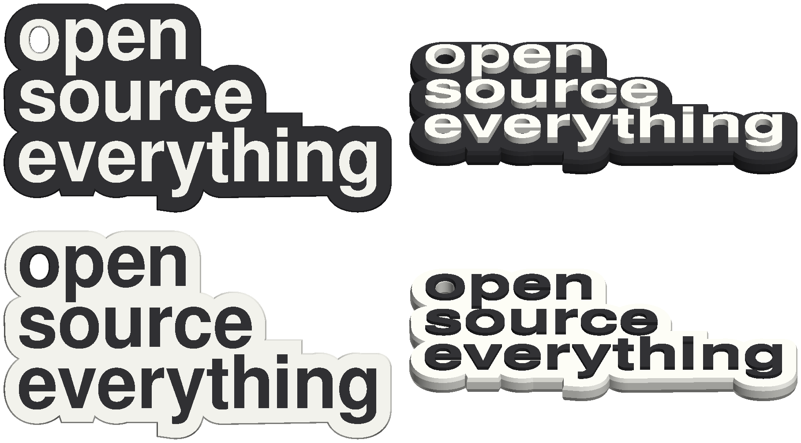

# Keychain

The "open source everything" keychain, split into a base and its letters so the letters print in a second color.
It comes in two versions that share the same base: light letters on a dark base, and dark letters on a light base.
The `o` of "open" acts as the hole for the key ring.

## Files

- [keychain.3mf](keychain.3mf): an OrcaSlicer project with both versions, ready to print on a Bambu Lab P1S with a 0.4 mm nozzle.
  By the slicer's estimate, they take about 22 and 20 minutes, and 6.2 and 5.4 g of filament.
- Components:
  - [keychain-base.stl](keychain-base.stl): the base, 62 x 33 x 2.8 mm, shared by both versions.
  - [keychain-letters-light.stl](keychain-letters-light.stl): 1.12 mm letter option for light colored filaments.
  - [keychain-letters-dark.stl](keychain-letters-dark.stl): 0.56 mm letter option for dark filaments.
- Combined (base plus letters):
  - [keychain-combined-light.stl](keychain-combined-light.stl): for light letters on a dark base.
  - [keychain-combined-dark.stl](keychain-combined-dark.stl): for dark letters on a light base.

## Why the light letter option has more layers

Light filament is slightly translucent, so light letters over a dark base need more layers to fully block the effects of the base color.

Dark filament easily covers a light base in fewer layers. Dark text also looks better standing lower; shadows affect the perceived crispness of the text if the letters are extruded too high above the base.

## Printing

The 3MF file (OrcaSlicer) already has all the settings below, with one plate per version.
It uses the Generic PLA profiles; swap in your own calibrated ones if you have them.
Settings that apply only to the letters are set on the letters part.

With the component STLs, load the base and one set of letters as a single object of two parts, then apply the settings below.

With a combined STL, it's up to you to set the layer where the color changes.
The base ends and the letters start at 2.8 mm.

## Settings

- **0.16 mm layers** (the "0.16mm Optimal" process) and a textured PEI plate.
- **Arachne wall generator.**
  The dot on the `i` is too small for the default Classic wall generator, which prints it as an empty outline.
  Arachne fills it.
- **4 walls and 100% infill**, so the keychain is solid.
- **Prime tower off.**
  All the letter layers sit above all the base layers, so each version needs only one filament change, and the AMS purges it through the chute.
- **"Only one wall on top surfaces" off, except on the letters.**
  Off, the base's top prints as one even pass.
  On the letters, their tops print as an outline and fill rather than as loops with small pits where the loops meet.
- **The letters' top fill direction ("Solid infill direction"): 75 degrees for the light letters, 165 for the dark.**
  At this angle the top layer covers tiny holes that the walls leave where strokes narrow, such as at the top of the `g`.
  The two settings lay the top lines the same way.
  Orca turns the solid fill direction a quarter turn from one layer to the next, and the dark letters' top layer is three layers lower than the light letters' top, an odd number, so the same setting would lay its lines crosswise.
  165 is 75 plus that quarter turn.
- **"Precise wall" off on the letters.**
  The crossbar of the `e` is only two lines wide.
  With precise wall on, the two lines are laid edge to edge, and with some filaments that left a thin slit down the middle in testing.
  Off, they overlap slightly.
