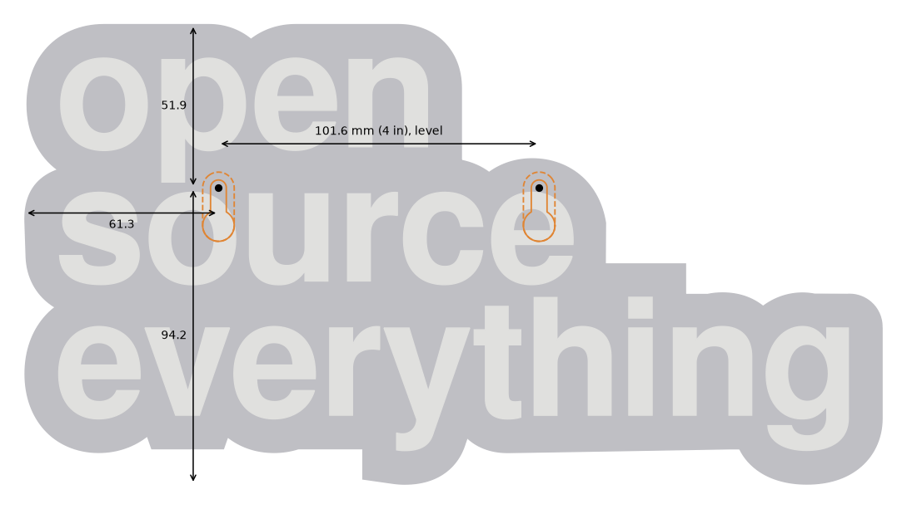
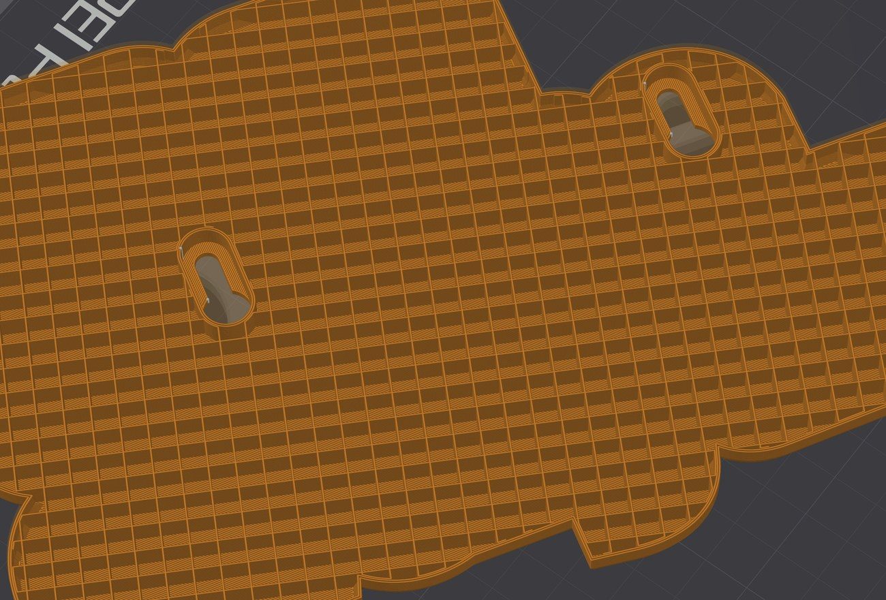

# Wall sign

The keychain design scaled up into a wall sign as large as a 256 mm build plate allows: 271.5 x 146 mm, with a base 11.2 mm thick and letters raised 4.48 mm.
The key ring's hole is filled, and two keyholes in the back hang it on two nails.
To enhance its presentation at this scale, the sign has chamfered edges: 3 mm on the front edge of the base and 0.6 mm on the top edges of the letters.

## Files

- [wall-sign-orcaslicer.3mf](wall-sign-orcaslicer.3mf): an OrcaSlicer project, ready to print on a Bambu Lab P1S with a 0.4 mm nozzle.
  By the slicer's estimate, it takes about 3 hours 25 minutes and 130 g of filament.
- Components:
  - [wall-sign-base.stl](wall-sign-base.stl): the base, 271.5 x 146 x 11.2 mm.
  - [wall-sign-letters.stl](wall-sign-letters.stl): the letters, 4.48 mm high.
- Combined (base plus letters): [wall-sign-combined.stl](wall-sign-combined.stl).

The STLs are turned 59 degrees, as the sign sits on the plate.

## Printing

The sign prints turned 59 degrees, which lets it use the plate's diagonal; square to the plate it would stop at 248 mm.
Centered on the plate, it stays clear of the P1S's excluded front-left corner and of the line the printer draws along the front edge to prime the nozzle.

The OrcaSlicer 3MF file already has all the settings below.
It uses the Generic PLA profiles; swap in your own calibrated ones if you have them.

With the component STLs, load the base and the letters as a single object of two parts, then apply the settings below.

With the combined STL, it's up to you to set the layer where the color changes.
The base ends and the letters start at 11.2 mm.

## Settings

- **No brim.**
  OrcaSlicer's automatic brim ran out to the plate's edges and over the priming line.
- **Top lines rising at 45 degrees to the text,** on both the base and the letters.
  With the sign turned on the plate, the usual setting of 45 degrees runs them nearly along the text or upright across it.
  Slicers turn the solid infill a quarter turn from one layer to the next, so the solid infill direction that gives this angle is either 14 or 104 degrees, depending on whether the top layer is odd or even.
  That can differ with the layer height, so check the top layers of the base and the letters in the preview.

Layer height shows mostly on the chamfers.
The base's chamfer steps once per layer, while the chamfer on the letters' top edges shows about four steps at 0.16 mm layers and two at 0.20 mm.

### OrcaSlicer only

- **The stock "0.20mm Standard" process.**
- **Prime tower off.**
  All the letter layers sit above all the base layers, so the sign needs only one filament change, and the AMS purges it through the chute.

## Hanging

Two nails, level and 101.6 mm (4 in) apart, each 51.9 mm below the top of the sign, the left one 61.3 mm in from the sign's left edge.
Leave the nails standing out about 5 mm; anything from 3.1 to 6.5 mm fits a nail with a 1.5 mm head.
The spacing is centered on the sign's center of mass.

