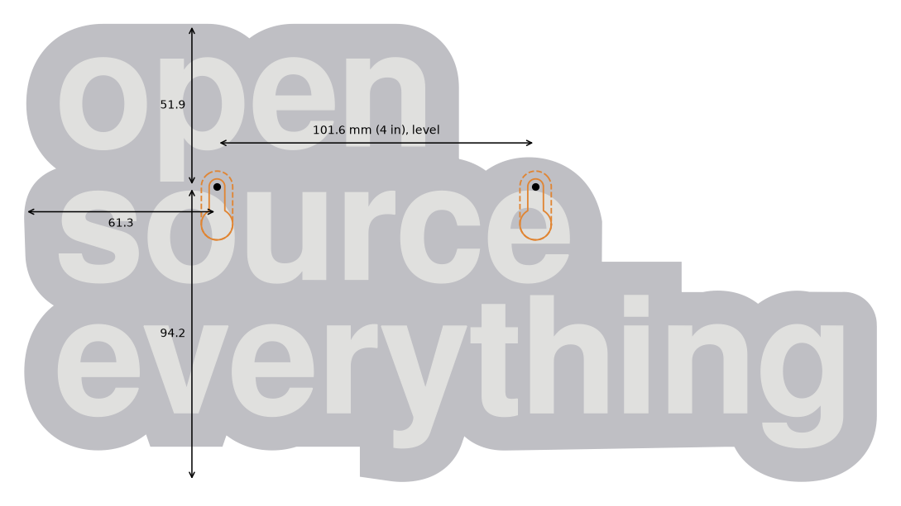
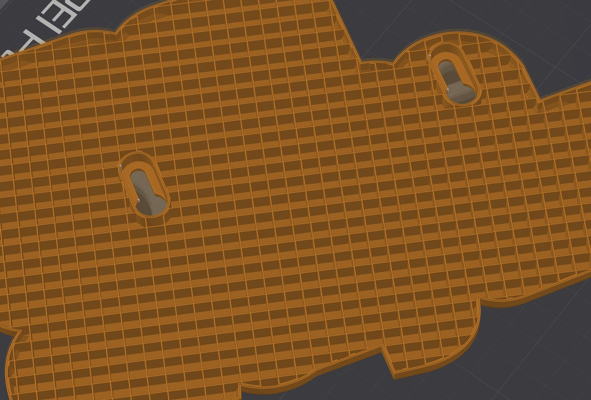

# Wall sign

The keychain design scaled up into a wall sign as large as a 256 mm build plate allows: 271.5 x 146 mm, with a base 11.2 mm thick and letters raised 4.48 mm.
The key ring's hole is filled, and two keyholes in the back hang it on two nails.
To enhance its presentation at this scale, the sign has chamfered edges: 3 mm on the front edge of the base and 0.6 mm on the top edges of the letters.

## Files

- [wall-sign-orcaslicer.3mf](wall-sign-orcaslicer.3mf): an OrcaSlicer project, ready to print on a Bambu Lab P1S with a 0.4 mm nozzle.
  By the slicer's estimate, it takes about 3 hours 25 minutes and 130 g of filament.
- [wall-sign-prusaslicer.3mf](wall-sign-prusaslicer.3mf): a PrusaSlicer project, ready to print on an Original Prusa MK4 (Input Shaper) with a 0.4 mm nozzle, with the sign scaled to 93% in X and Y to fit its plate (see [Plate sizes](#plate-sizes)).
  It uses the "0.20mm STRUCTURAL" process and a manual color change at 11.4 mm; by the slicer's estimate, it takes about 4 hours 20 minutes and 121 g of filament.
- Components:
  - [wall-sign-base.stl](wall-sign-base.stl): the base, 271.5 x 146 x 11.2 mm.
  - [wall-sign-letters.stl](wall-sign-letters.stl): the letters, 4.48 mm high.
- Combined (base plus letters): [wall-sign-combined.stl](wall-sign-combined.stl).

The STLs are square to the axes; the OrcaSlicer 3MF turns the sign 59 degrees on the plate.

## Printing

On a 256 mm plate, the sign prints turned 59 degrees, which lets it use the plate's diagonal; square to the plate, it could be at most 248 mm wide.
Centered on the plate, it stays clear of the P1S's excluded front-left corner and of the line the printer draws along the front edge to prime the nozzle.
For other plates, [Plate sizes](#plate-sizes) gives the scale and turn.

The OrcaSlicer 3MF file already has all the settings below.
It uses the Generic PLA profiles; swap in your own calibrated ones if you have them.

With the component STLs, load the base and the letters as a single object of two parts, then apply the settings below.

With the combined STL, it's up to you to set the layer where the color changes.
The base ends and the letters start at 11.2 mm.

## Settings

- **No brim.**
  OrcaSlicer's automatic brim ran out to the plate's edges and over the priming line.
- **Top lines rising at 45 degrees to the text,** on both the base and the letters.
  Slicers turn the solid infill a quarter turn from one layer to the next, so the solid infill direction that gives this angle is one of two, depending on whether the top layer is odd or even.
  With the sign square to the plate, it is 45 or 135 degrees; with the sign turned, add the turn, counting clockwise as negative ([Plate sizes](#plate-sizes) lists both for each turn).
  Which of the two applies can change with the layer height, so check the top layers of the base and the letters in the preview.

Layer height shows mostly on the chamfers.
The base's chamfer steps once per layer, while the chamfer on the letters' top edges shows about four steps at 0.16 mm layers and two at 0.20 mm.

### OrcaSlicer only

- **The stock "0.20mm Standard" process.**
- **Prime tower off.**
  All the letter layers sit above all the base layers, so the sign needs only one filament change, and the AMS purges it through the chute.

## Plate sizes

The STLs are full size and square to the axes.
To fit a plate, scale them in X and Y and turn them as below.
Keep Z at 100%, so the keyholes stay as deep and the letters still start at 11.2 mm.
Each row leaves at least 2.8 mm between the sign and the plate's edges, and the hanging measurements scale too (see [Hanging](#hanging)).

| Plate (mm) | Scale (X and Y) | Turn | Solid infill direction |
|---|---|---|---|
| 360 x 360 | 142% | 59° counterclockwise | 14° or 104° |
| 300 x 300 | 118% | 59° counterclockwise | 14° or 104° |
| 256 x 256 | 100% | 59° counterclockwise | 14° or 104° |
| 250 x 210 or 250 x 220 | 93% | 20° clockwise | 25° or 115° |
| 220 x 220 | 86% | 59° counterclockwise | 14° or 104° |
| 180 x 180 | 70% | 59° counterclockwise | 14° or 104° |

## Hanging

Two nails, level and 101.6 mm (4 in) apart, each 51.9 mm below the top of the sign, the left one 61.3 mm in from the sign's left edge.
Leave the nails standing out about 5 mm; anything from 3.1 to 6.5 mm fits a nail with a 1.5 mm head.
The spacing is centered on the sign's center of mass.

Scaled in X and Y only, the keyholes keep their depth, so the nails stand out the same, while the keyholes' sizes and the nails' positions scale with the sign:

| Scale | Max head (mm) | Max shank (mm) | Nails apart (mm) |
|---|---|---|---|
| 142% | 14.2 | 7.1 | 144.3 |
| 118% | 11.8 | 5.9 | 119.9 |
| 100% | 10 | 5 | 101.6 |
| 93% | 9.3 | 4.65 | 94.5 |
| 86% | 8.6 | 4.3 | 87.4 |
| 70% | 7 | 3.5 | 71.1 |

The head of the nail or screw must also be wider than the max shank, since the lip around the shank's slot is what holds it.
